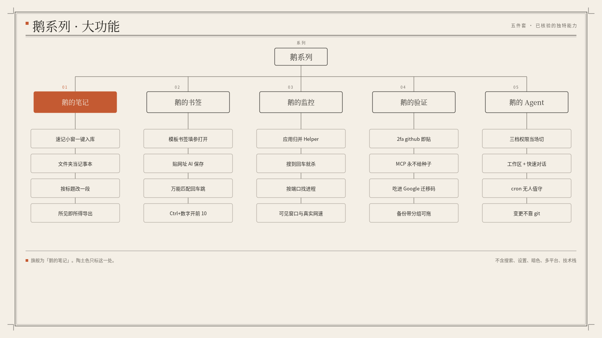

# 鹅的笔记

> 本地化的 Notion 风格笔记，uTools 插件。

> 本仓库只发布 uTools 插件。桌面版已改名为「思绪 · Thinkly」，在 [eachann1024/goose-note](https://github.com/eachann1024/goose-note)，两边分开开发和发布。

把本机 Markdown 文件夹和独立速记小窗收成一本可被助手读写的笔记，而不是再做一个云端 Notion。

## 演示视频

https://github.com/user-attachments/assets/95f9bf50-3992-4f99-a256-b52ee6f41b74

视频取自桌面版。其中 Git 同步为桌面版功能，uTools 插件没有；其余本地 Markdown、速记小窗、块编辑器、WebDAV 备份、自带 Key 的 AI、历史里程碑与导出，插件都有。

## 大功能

- **速记小窗入库**：独立「鹅的小窗」常驻，写完一键进主笔记，不打断当前窗口。
- **文件夹当记事本**：挂上本机目录就能当一本笔记，卸挂载不删磁盘上的文件。
- **按标题改一段**：助手按 Markdown 读写；指定标题只改那一段，删笔记进回收站。
- **按你看见的样子导出**：PDF / Word / 图按所见出，中文、图表、公式、本地图片都进，不是倒源码。
- **锁定页与里程碑**：锁定后助手不能删；历史有上限，淘汰时留住你标过的里程碑。

## 系列

## 同系列

- [思绪 · Thinkly（桌面版）](https://github.com/eachann1024/goose-note)
- [鹅的书签](https://github.com/eachann1024/goose-mark)
- [鹅的监控](https://github.com/eachann1024/goose-monitor)
- [鹅的验证](https://github.com/eachann1024/goose-2fa)
- [鹅的 Agent](https://github.com/eachann1024/eachann1024)

## 联网与隐私说明

默认纯本地离线运行，应用启动与日常笔记编辑不连接外部服务器。仅在你主动使用以下功能时访问网络：

- **AI 对话与联网搜索**：发送消息时访问你所选模型服务商或自定义的 Base URL 域名（如 `api.openai.com`、`api.anthropic.com`、`api.deepseek.com` 等），联网搜索时访问搜索服务与目标网页域名。
- **WebDAV 同步备份**：触发备份或恢复时访问你配置的 WebDAV 服务器域名。
- **外链图片**：笔记中包含远程图片链接时访问对应图片所在域名。
- **匿名统计与错误上报**：默认关闭；仅在你显式开启后，按配置的遥测/Sentry 域名上报匿名计数或异常摘要，不含笔记内容。

开发说明见 [DEVELOP.md](DEVELOP.md)。

桌面版安装包在 [goose-note](https://github.com/eachann1024/goose-note)。磁盘上的包名仍是 `Goose Note.app`，用来保住已有数据目录。

## 许可

当前源码使用 MIT；第三方部分保留原许可与署名，见 [LICENSE](LICENSE) 与 [THIRD-PARTY-NOTICES.txt](THIRD-PARTY-NOTICES.txt)。旧版本按原发布许可使用。
